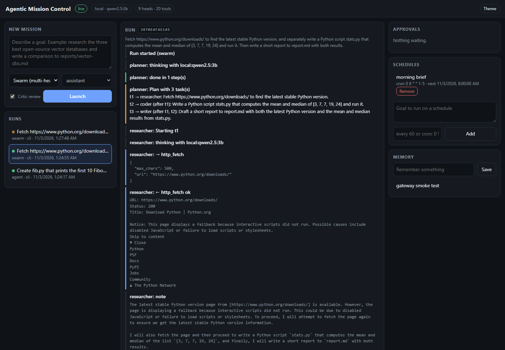

# Agentic

### A local-first, multi-head agent runtime that can use your computer. One goal in, a team of specialist agents out.

[](https://github.com/divyanshu-iitian/Agentic/actions/workflows/ci.yml)
[](LICENSE)
[](pyproject.toml)
[](#models)
[](#mcp-servers)
[](#computer-use)

Agentic runs a team of AI agents on your own machine. You give it a goal. A
**planner** splits the goal into a dependency graph of tasks. Specialist
**heads** (researcher, coder, analyst, operator, writer) work on those tasks,
**in parallel** when the tasks don't depend on each other. A **critic** checks
the results and can send work back for revision. A **synthesizer** then writes
the final answer.

The heads can **operate your computer** (see the screen, click, type, drag, and
draw in any app), **drive a real browser** (fill forms, click through sites),
read and write files, run code and shell commands, call any
[MCP](https://modelcontextprotocol.io) server, remember facts between sessions,
and schedule their own recurring jobs. You can drive it from a terminal, a web
dashboard, an HTTP API, or Telegram.

<p align="center">
  
  <br>
  <sub>Agentic's computer-use tools drawing in Microsoft Paint on Windows 11. They found the
  canvas and colors through the accessibility tree, then drew with real mouse input.</sub>
</p>

It is **local by default**: [Ollama](https://ollama.com) runs the models, and
SQLite stores memory and history on your disk. Cloud models (OpenAI-compatible
APIs, Anthropic) are optional, and you can choose a model per head.



> **Status: pre-1.0.** The runtime is tested (128 automated tests, run in CI on
> Linux and Windows), but agents act on your machine. Keep approvals on for
> anything that writes, executes, or touches the desktop. Stop any run with
> `Ctrl + Alt + Q` or by moving the mouse into a screen corner. See
> [Safety model](#safety-model).

---

## Contents

- [What you get](#what-you-get)
- [Computer use](#computer-use)
- [How a swarm works](#how-a-swarm-works)
- [Quick start](#quick-start)
- [Models](#models)
- [Heads](#heads)
- [Tools and permissions](#tools-and-permissions)
- [Safety model](#safety-model)
- [Memory, schedules, and channels](#memory-schedules-and-channels)
- [MCP servers](#mcp-servers)
- [Gateway, dashboard, and API](#gateway-dashboard-and-api)
- [CLI reference](#cli-reference)
- [Configuration](#configuration)
- [Architecture](#architecture)
- [Limitations](#limitations)
- [Development](#development)

## What you get

| Capability | Details |
| --- | --- |
| **Multi-head swarms** | A planner builds a task graph and specialist heads execute it concurrently (`max_parallel`). Each task receives the outputs of the tasks it depends on. |
| **Critic and revision loop** | A critic reviews results against the goal. It can send named tasks back with specific fix instructions, for a configurable number of rounds. |
| **Delegation** | Any head can hand a subtask to another head with the `delegate` tool. Depth is limited to prevent runaway recursion. |
| **Computer use** | 15 desktop tools. Eyes: the Windows accessibility tree, screenshots with a coordinate grid for vision models, and OCR. Hands: click, type, hotkeys, drag, draw shapes, scroll, and window control, all sent as real input events. |
| **A real browser** | A persistent Playwright session. Pages come back as numbered elements (`[12] button "Sign in"`), and the agent clicks, types, selects, and submits by number. Logins persist between runs. |
| **Vision** | Screenshots go straight to vision models (Ollama vision models are auto-detected; Anthropic and OpenAI-compatible APIs are supported). Older screenshots are dropped from context automatically. |
| **39 built-in tools** | Files, regex search, shell, Python, web search, page fetch, browser, desktop, memory, scheduling, and delegation. |
| **MCP client** | Connects to any stdio MCP server. Its tools appear as `mcp__<server>__<tool>` and run under a permission tier you set. |
| **Any model, per head** | Ollama, any OpenAI-compatible API (OpenAI, Groq, OpenRouter, LM Studio, vLLM), or Anthropic. A prompt-based tool mode supports small models that lack native tool calling. |
| **Human approvals** | Each tool has a permission tier: `auto`, `ask`, or `deny`. You approve requests in the terminal, the dashboard, or Telegram. You can approve once or for the rest of a run. |
| **Persistent memory** | SQLite with FTS5 and BM25 ranking. Relevant memories are added to each head's prompt automatically. |
| **Schedules** | Recurring goals by interval or cron (`0 9 * * 1-5`). Scheduled runs are unattended, so they get a stricter permission policy. |
| **Mission Control** | A dashboard with live event streaming (SSE), an approvals queue, run history and replay, schedules, and memory. It has no build step and no CDN dependencies. |
| **Telegram channel** | Chat with your agents from your phone. Long polling means you don't need a public URL. Only allow-listed chats get a response. |
| **Full event log** | Every plan, tool call, result, verdict, and answer is stored. Use `agentic runs <id>` to replay a run. |
| **Skills** | `SKILL.md` instruction packs are added to a head's prompt only when the task matches them. |
| **Custom heads** | Write a Markdown file to add a new specialist, or to override a built-in one. |

## Computer use

Ask in plain language:

```bash
agentic run "Open MS Paint and draw a house with a sun" --head operator
agentic run "Open Notepad and write a short poem about the monsoon" --head operator
agentic run "Search Wikipedia for the Taj Mahal and tell me when it was completed" --head navigator
agentic chat     # then: /computer open calculator and work out 1234 * 5678
```

The **operator** head works in an observe → act → verify loop:

| Step | Tools | How it works |
| --- | --- | --- |
| See | `desktop_ui_tree` | Reads the Windows accessibility tree. Every button, menu, field, list item, and canvas comes back numbered with exact screen positions, e.g. `[40] Button "Pencil" at (326,111)`. This is precise, works with text-only models, and is the main way the agent sees. |
| See | `desktop_screenshot` | For vision models: the screen as an image with a coordinate grid labeled in real screen pixels, so the model can aim. |
| See | `desktop_read_screen`, `desktop_windows` | OCR text with positions (needs Tesseract), and the list of open windows (minimized ones included). |
| Act | `desktop_click_element`, `desktop_click`, `desktop_type`, `desktop_hotkey` | Click by element number or coordinates, type any text (including non-ASCII on Windows), and press shortcuts. |
| Act | `desktop_drag`, `desktop_draw`, `desktop_move`, `desktop_scroll` | Drag along a path. Draw lines, polygons, rectangles, circles, and ellipses inside a canvas on a 0-1000 grid, where circles stay round on any canvas shape. |
| Act | `desktop_open_app`, `desktop_window` | Launch apps; focus, maximize, minimize, or restore windows without stray keypresses. |

The **navigator** head drives a real Chromium browser:

```text
[navigator] → browser_open {"url": "https://example.com/signup"}
  Page: Sign up   Interactive elements:
  [3] input text "Email"   [4] input password "Password"   [5] button "Create account"
[navigator] → browser_type {"ref": 3, "text": "me@example.com"}
[navigator] → browser_click {"ref": 5}
```

Built for reliability:
- Drawing and dragging use real `mouse_event` input on Windows. Modern apps
  such as the new Paint ignore the cursor jumps that pyautogui uses, so strokes
  drawn that way silently vanish.
- Windows are brought to the front without pressing Alt, which would open
  ribbon key tips in Office and Paint.
- Repeat detection only stops identical calls made back to back, so an
  observe → act → observe cycle is never mistaken for a loop.

The drawing above was made on Windows 11 by calling Agentic's tools directly.
How well a *model* does the same task depends on the model (see
[Models](#models)): text-only models plan from the accessibility tree, and
vision models can also check their work in screenshots.

**Stop anytime:** press `Ctrl + Alt + Q`, or move the mouse into any screen
corner. Either stops every head, even in the middle of a stroke. All desktop
actions need the `desktop` permission. Clicking and typing on websites needs
the `browser` permission. Both ask you by default.

## How a swarm works

```text
                  ┌──────────────────────────────────────────────┐
  goal ──► planner ──► task graph (JSON, validated, made acyclic)│
                  └──────────────────────────────────────────────┘
                              │
          ┌───────────────────┼────────────────────┐
          ▼                   ▼                    │   independent tasks
     researcher            coder                   │   run in parallel
   (web_search,        (write_file,                │
    http_fetch)         run_command)               │
          └─────────┬─────────┘                    │
                    ▼                              │   dependent tasks start
                 writer  ◄── outputs of t1, t2 ────┘   when their inputs are ready
                    │
                    ▼
                 critic ──► approved? ── no ──► re-run named tasks with feedback
                    │ yes                       (up to max_revisions rounds)
                    ▼
               synthesizer ──► final answer
```

Here is a real run on a laptop with `qwen3.5:9b` through Ollama, condensed from
the terminal:

```text
$ agentic swarm "Fetch python.org/downloads to find the latest stable Python version, and
  separately write stats.py that computes the mean and median of [3, 7, 7, 19, 24] and run
  it. Then write a short report to report.md with both results." --allow write,execute

▸ Plan (3 tasks)
  t1 → researcher: Visit https://www.python.org/downloads/ and extract the latest stable Python version
  t2 → coder: Create stats.py that computes mean and median of [3, 7, 7, 19, 24], then run it
  t3 → writer after t1, t2: Write report.md containing (1) the version from t1, (2) the results from t2
[researcher] → http_fetch {"url": "https://www.python.org/downloads/"}
[coder] → write_file {"path": "stats.py", ...}                 ← t1 and t2 run at the same time
[coder] → run_command {"command": "python stats.py"}
[coder]   ← ok exit code: 0  stdout: Mean: 12.0  Median: 7
[researcher] ✓ t1 Latest Stable Python Version: 3.15.2 ...
[coder] ✗ t2 (the model returned an empty answer)
[writer] → write_file {"path": "report.md", ...}
[critic] → read_file {"path": "report.md"}                     ← the critic checks the deliverable
[critic] requested changes to t2: (coder) returned empty answer ...
[coder] revising t2
[coder]   ← ok exit code: 0  stdout: Mean: 12.0  Median: 7

Result: Latest stable Python version 3.15.2 · Mean 12.0 · Median 7 · files: stats.py, report.md
```

That run predates a fix for one failure it shows. The coder's model ended its
task with an empty reply, and the critic caught it. Heads now ask the model
once more when a reply is empty.

The planner's JSON is treated as untrusted. Unknown heads fall back to the
assistant. A task can only depend on tasks listed before it, so cycles cannot
occur. If the planner returns invalid JSON twice, the goal goes to the assistant
as a single task, so a run always makes progress.

## Quick start

**Requirements:** Python 3.10+ and [Ollama](https://ollama.com). CI tests
Windows and Linux. macOS should work, but it is not tested yet. The desktop
tools need a graphical session.

```bash
git clone https://github.com/divyanshu-iitian/Agentic.git
cd Agentic
python -m venv .venv
# Windows: .venv\Scripts\activate    macOS/Linux: source .venv/bin/activate
pip install -e ".[all]"          # core + computer use (desktop, browser); plain "." for core only
playwright install chromium      # the agent's browser

ollama pull qwen2.5:3b           # or a larger model, see "Models"
agentic init                     # writes agentic.yaml and creates ./workspace
agentic doctor                   # checks the model, workspace, and optional extras
```

Then try each surface:

```bash
agentic chat                                         # conversation with memory; /swarm <goal> inside
agentic run "List the files in the workspace and summarize them"
agentic run "Write and run a script that prints primes below 50" --head coder
agentic swarm "Research the three most popular Python web frameworks and write a comparison to reports/frameworks.md"
agentic serve                                        # dashboard at http://127.0.0.1:8765
```

When a head wants to write, execute, schedule, or use the desktop, the terminal
asks you `Allow? [y]es / [n]o / [a]lways this run`. To approve tiers ahead of
time, use `--allow write,execute`. `--yes` approves every tier that is set to
`ask`, so only use it in a disposable workspace.

## Models

Configure as many providers as you want, then set which one each head uses.

| Machine | Suggested model | What to expect |
| --- | --- | --- |
| 8 GB RAM, CPU only | `qwen2.5:3b` | Good for chat and single-head tasks such as writing and running a script. Swarm planning works, but small models make factual and reasoning mistakes. |
| 16 GB RAM | `qwen2.5:7b`, `qwen3.5:9b`, `llama3.1:8b` | Noticeably better plans, tool use, and critique. Recommended for swarms. |
| GPU or a cloud key | 14B+ local, or a hosted model | The most reliable multi-step research and coding. |

For computer use, prefer a **vision** model such as `qwen3.5:9b`,
`qwen2.5vl:7b`, or `gemma3`. It can check its own work in screenshots. Agentic
asks Ollama whether a model supports images and only offers screenshot tools to
models that do; `agentic doctor` shows the result. Text-only models still work:
they see apps through the accessibility tree.

We tested the swarm above on the same CPU-only laptop with both models. With
`qwen2.5:3b`, the run took 52 seconds, and the plan and tool calls worked. But
the model miscalculated the mean and invented a Python version after reading
only part of the page, and the critic did not catch either mistake. With
`qwen3.5:9b`, both answers were correct, and the critic caught and repaired a
failed task. That run took about 22 minutes. Use a larger model for any work
where correctness matters, and a GPU if you want it fast.

Mix models per head. For example, use a cloud model for planning and critique
and a local model for everything else:

```yaml
default_provider: local
providers:
  local:  { type: ollama, model: qwen2.5:7b }
  claude: { type: anthropic, api_key_env: ANTHROPIC_API_KEY, model: claude-sonnet-5-5 }
  groq:   { type: openai, base_url: https://api.groq.com/openai/v1,
            api_key_env: GROQ_API_KEY, model: llama-3.3-70b-versatile }
```

```markdown
<!-- heads/planner.md overrides the built-in planner -->
---
name: planner
description: Breaks a goal into a dependency graph of tasks for specialist heads.
tools: [recall, list_dir]
provider: claude
---
You are the Planner head ...
```

If a small local model ignores native tool calls, set `tool_mode: prompt` on its
provider. Agentic then describes the tools in the system prompt and parses a
JSON reply instead.

## Heads

| Head | Role | Tools |
| --- | --- | --- |
| `assistant` | Generalist. Default for `chat` and `run`. Can delegate. | all tools |
| `planner` | Turns a goal into a task graph | `recall`, `list_dir` |
| `researcher` | Searches, reads sources, and cites URLs | web, browser (reading), memory, files |
| `coder` | Writes, edits, runs, and tests code | files, shell, Python |
| `analyst` | Analyzes data with Python and reports numbers | files, Python |
| `operator` | Computer use: operates any desktop app; sees via the accessibility tree and screenshots | all `desktop_*`, shell, files (read) |
| `navigator` | Operates websites in a real browser: forms, logins, multi-page flows | all `browser_*`, web, memory |
| `writer` | Drafts documents and reports | files, memory |
| `critic` | Checks results against the goal and requests fixes | files (read-only) |
| `synthesizer` | Merges the results into the final answer | none |

To add a head, put a Markdown file in `heads/`. A file with a built-in head's
name replaces that head. The `tools` list accepts glob patterns such as
`mcp__github__*`.

```markdown
---
name: devops
description: Diagnoses build and deployment problems.
tools: [read_file, search_files, run_command, http_fetch, "mcp__github__*"]
provider: local
max_steps: 20
---
You are the DevOps head. Reproduce the failure before proposing a fix ...
```

Run `agentic heads` to list the heads that are loaded and where each one comes from.

## Tools and permissions

| Tool | Tier | Default | Notes |
| --- | --- | --- | --- |
| `list_dir`, `read_file`, `search_files`, `list_schedules` | read | auto | File access is limited to the workspace |
| `remember`, `recall` | memory | auto | SQLite FTS5 |
| `web_search`, `http_fetch`, `browser_render` | network | auto | Public hosts only, checked again after redirects. `browser_render` needs Playwright. |
| `write_file`, `edit_file` | write | **ask** | Limited to the workspace |
| `run_command`, `run_python` | execute | **ask** | Run with the workspace as the working directory. A guard blocks known destructive commands. |
| `schedule_task` | schedule | **ask** | Creates recurring automations |
| `browser_open`, `browser_snapshot`, `browser_scroll`, `browser_back`, `browser_screenshot` | network | auto | Reading pages in the agent's browser. Every request is checked like `http_fetch`. |
| `browser_click`, `browser_type`, `browser_select`, `browser_press` | browser | **ask** | Can submit forms, so they ask first |
| `desktop_*` (15 tools: see, click, type, hotkey, drag, draw, scroll, windows) | desktop | **ask** | `desktop_wait` is read-only. The accessibility tree needs `uiautomation` on Windows; OCR needs Tesseract. |
| `delegate` | read | auto | The delegated head's own tool calls are still checked |
| `mcp__<server>__<tool>` | per server | per tier | Set with `permission:` in the server's config |

Run `agentic tools` to see each tool's tier and the policy currently applied to it.

## Safety model

Agentic is built on the assumption that model output and tool output are
untrusted.

- **Approvals are the boundary.** Every tool call is checked against the policy
  for its tier. If a call needs approval and no approver is attached, it is
  denied. Approvals that time out are denied.
- **Unattended runs are stricter.** For scheduled runs, `ask` becomes `deny`
  unless the tier is listed in `scheduler.unattended_permissions` (by default
  only `read`, `memory`, and `network`).
- **Workspace confinement.** File tools resolve symlinks and `..` and refuse any
  path outside the workspace. Shell and Python commands start in the workspace.
  This sets their working directory only; it does not sandbox them, so a command
  you approve can reach any file your user account can.
- **Destructive-command guard.** Patterns such as `rm -rf /`, `format c:`,
  `mkfs`, disk wipes, and shutdowns are refused even if approved. This guard is
  defense in depth, not a sandbox.
- **SSRF protection.** Web tools refuse loopback, private, link-local, and
  metadata addresses, including after redirects and for browser subresources.
  An optional domain allowlist restricts access further.
- **Prompt-injection hygiene.** Every head is told that web pages, files, screen
  text, and tool results are data, not instructions. This lowers the risk but
  does not remove it. That is why approvals exist.
- **Strict tool arguments.** Arguments are checked against each tool's schema,
  and unknown arguments are rejected. Tool output is truncated, and tools have
  timeouts.
- **Gateway hardening.** The gateway binds to `127.0.0.1` by default. It refuses
  cross-origin requests and unexpected `Host` headers, which blocks drive-by
  requests and DNS rebinding. It will not bind to a public interface unless
  `AGENTIC_TOKEN` is set, and every API call then needs that bearer token.
- **Emergency stop.** `Ctrl + Alt + Q` (in the CLI, through the `keyboard`
  package) or moving the mouse into a screen corner stops every head, even
  mid-stroke. The next run starts fresh.
- **Browser actions are separate from browsing.** Reading pages is `network`.
  Clicking, typing, and pressing keys on a page is `browser` (ask by default).
  The navigator head is told never to enter credentials or payment details, or
  to finish a purchase, unless your goal says so.
- **Telegram allowlist.** The bot ignores chats that are not listed in
  `allowed_chat_ids`.

Use a dedicated workspace. Review custom heads, skills, and MCP servers before
you install them, because they shape what the agents do.

## Memory, schedules, and channels

**Memory.** Heads save facts with `remember` and look them up with `recall`.
The three memories most relevant to the current task are also added to each
head's prompt automatically. You can manage memory with `agentic memory
add|search|list|delete`, from the dashboard, or with `/remember` in chat.

**Schedules.** Schedules run while `agentic serve` is running.

```bash
agentic schedule add "Summarize the top Hacker News stories about AI" --cron "0 8 * * 1-5"
agentic schedule add "Check https://example.com is up and remember any outage" --every 30
agentic schedule list
```

Heads can also create schedules themselves with `schedule_task`, which needs
your approval. A schedule created from Telegram sends its results back to that
chat.

**Telegram.**

1. Create a bot with [@BotFather](https://t.me/BotFather).
2. Set the `TELEGRAM_BOT_TOKEN` environment variable to the bot's token.
3. Set `channels.telegram.enabled: true` in `agentic.yaml`.
4. Run `agentic serve` and send the bot a message. The log prints your chat ID.
5. Add that ID to `allowed_chat_ids` and restart the server.

Approval requests appear in the chat; answer with `/approve <id>` or `/deny <id>`.
Other chat commands: `/swarm`, `/run`, `/computer`, `/browse`, `/remember`, `/memories`, `/schedules`,
`/reset`, and `/help`.

## MCP servers

MCP turns other open-source automation projects into extra hands for your
heads. Add any stdio MCP server to `agentic.yaml`. The server is started when
the CLI or gateway starts, and its tools are registered for every head whose
`tools` list matches them. MCP tools can also return images, which vision
models receive like screenshots.

```yaml
mcp_servers:
  filesystem:
    command: npx
    args: ["-y", "@modelcontextprotocol/server-filesystem", "./workspace"]
    permission: write
  playwright:                      # Microsoft's browser automation server
    command: npx
    args: ["-y", "@playwright/mcp@latest"]
    permission: browser
```

`env` values can reference environment variables, for example
`env: { API_TOKEN: "${MY_TOKEN}" }`, so secrets stay out of the file.

`agentic doctor` starts each configured server and reports how many tools it
provides. If a server fails to start, Agentic reports the error and continues
without that server's tools.

## Gateway, dashboard, and API

`agentic serve` starts a single local process that hosts the Mission Control
dashboard, the REST API, a live event stream, the scheduler, the Telegram
channel, and any MCP servers you configured.

| Method | Path | Purpose |
| --- | --- | --- |
| `GET` | `/api/status` | Version, model, head, tool, and MCP counts, channel status |
| `GET` | `/api/heads`, `/api/tools` | The loaded heads, and the tools with their current policy |
| `POST` | `/api/runs` | Start a run: `{"goal", "mode": "agent" or "swarm", "head", "critic"}` |
| `GET` | `/api/runs`, `/api/runs/{id}` | Run history, and one run with its full event log |
| `POST` | `/api/runs/{id}/cancel` | Cancel an active run |
| `GET` | `/api/approvals` | Pending approval requests |
| `POST` | `/api/approvals/{id}` | Decide: `{"approve": true, "remember_for_run": false}` |
| `POST` | `/api/chat` | One chat turn: `{"message", "session"}` |
| `GET`, `POST`, `DELETE` | `/api/memories` | Search, add, and delete memories |
| `GET`, `POST`, `DELETE` | `/api/schedules` | List, create (`every_minutes` or `cron`), and delete schedules |
| `GET` | `/api/stream` | Server-Sent Events stream of every runtime event |

Interactive OpenAPI docs are served at `/docs`. To expose the gateway beyond
localhost, set `AGENTIC_TOKEN` and run `agentic serve --host 0.0.0.0`. Put it
behind TLS (a reverse proxy) when it is reachable over a network.

## CLI reference

```text
agentic init                       create agentic.yaml and the workspace
agentic doctor                     check providers, workspace, extras, and MCP servers
agentic chat [--session NAME]      interactive chat with memory and slash commands
agentic run GOAL [--head NAME]     run one head on a goal
agentic swarm GOAL [--no-critic]   run the multi-head team on a goal
agentic serve [--host] [--port]    start the gateway: dashboard, API, scheduler, channels
agentic heads | tools              list heads, or tools with their policies
agentic runs [RUN_ID]              list past runs, or replay one run's event log
agentic schedule add|list|remove   manage scheduled goals
agentic memory list|add|search|delete

Flags for run, swarm, chat, and tools:
  --provider NAME  --model NAME  --workspace DIR  --allow TIERS  -y/--yes  -v/--verbose
```

`python -m agentic` works the same way as the `agentic` command.

## Configuration

`agentic init` writes [`agentic.yaml`](agentic/templates/agentic.yaml), which
documents every option. Every key is optional. Without a config file, Agentic
uses local Ollama with `qwen2.5:3b`, a `./workspace` folder, and the permission
defaults in the tools table above.

| Section | Purpose |
| --- | --- |
| `providers`, `default_provider` | Model backends, and the one used by default |
| `permissions` | `auto`, `ask`, or `deny` for each tier |
| `limits` | Steps per head, parallel heads, tasks per plan, revision rounds, delegation depth, timeouts |
| `network` | Domain allowlist, and whether private hosts are allowed |
| `mcp_servers` | MCP servers to start, and each server's permission tier |
| `gateway` | Bind host, port, and the name of the token variable |
| `channels.telegram` | Bot token variable and allowed chat IDs |
| `scheduler` | How often to check for due schedules, and which tiers unattended runs may use |

API keys are never stored in the config file. Each provider names an
environment variable that holds its key (`api_key_env`).

## Architecture

```text
agentic/
  cli.py            terminal interface and live event renderer
  gateway.py        FastAPI server: REST, SSE, approvals, lifecycle
  runtime.py        wires settings, providers, tools, heads, memory, and events
  swarm.py          planner → parallel task graph → critic loop → synthesizer
  agent.py          one head's loop: think → call tools → observe → answer
  heads.py          Markdown head profiles (built-in and custom)
  approvals.py      permission tiers, approvers, pending requests
  scheduler.py      interval and cron execution with unattended policy
  store.py          SQLite: memories (FTS5), runs, events, chats, schedules
  events.py         event bus feeding the store, the CLI, the SSE stream, and channels
  cron.py           five-field cron parser
  llm/              Ollama, OpenAI-compatible, Anthropic, and prompt-mode tool calling
  tools/            files, shell, web, desktop, core (memory, schedule, delegate), MCP
  channels/         Telegram
  profiles/         built-in heads
  static/           Mission Control dashboard
```

Every surface (CLI, dashboard, API, Telegram, scheduler) uses the same
`Runtime`, so a run produces the same event log no matter where it started. See
[docs/architecture.md](docs/architecture.md) for details.

The repository also contains the earlier v0.1 surfaces. They still work, but new
development happens in `agentic/`.

- `main.py` and `core/`, `perception/`, `execution/`: the OCR-grounded desktop
  agent with a floating command bar (`Ctrl + Space`, emergency stop
  `Ctrl + Alt + Q`)
- `agentic-app/`: the React and FastAPI chat app

## Limitations

- **Quality depends on the model.** Small local models plan and use tools, but
  they make factual and reasoning mistakes. A critic running on the same small
  model often misses them. Use 7B+ models or a hosted model for important work.
- **Prompt injection is not solved.** Approvals, confinement, and SSRF checks
  limit the damage it can do, but cannot stop a model from being misled by
  content it reads.
- **Shell commands are not sandboxed.** The destructive-command guard catches
  obvious accidents. Your approval is the real control. Run Agentic in a VM or
  container if you want hard isolation.
- **Computer use is strongest on Windows.** The accessibility tree uses Windows
  UI Automation. On macOS and Linux, agents see the screen through screenshots
  (vision models) or OCR, which is less precise. Drawing and dragging use real
  input events on Windows and pyautogui elsewhere.
- **Small models are clumsy operators.** Seeing exact controls helps a lot, but
  long multi-app tasks still need a capable model, ideally a vision model.
  Watch the first runs, and keep the desktop permission on `ask`.
- **Apps without accessibility data** (some games and custom-drawn UIs) can only
  be seen through screenshots or OCR.
- **`web_search` uses DuckDuckGo's HTML endpoint.** It needs no API key, but it
  can be rate-limited or break if the page layout changes.
- **The MCP client supports stdio transport only.**

## Development

```bash
pip install -e ".[dev]" loguru     # loguru is used by the legacy v0.1 modules
python -m pytest                   # 128 tests; no model or internet needed
python -m ruff check .
```

The tests use a scripted provider to exercise the whole control flow
deterministically: the tool loop, approvals, the parallel task graph, critic
revisions, delegation, provider wire formats (including images), MCP over
stdio, the scheduler, the gateway API, the CLI, drawing geometry, screenshot
annotation, vision routing, and the emergency stop. One test drives a real
headless Chromium against a local page; it is skipped if Playwright is not
installed. CI runs the suite on Linux and Windows with Python 3.10 and 3.12.

Trying Agentic for the first time? [Share setup and hardware feedback](https://github.com/divyanshu-iitian/Agentic/issues/new?template=setup-feedback.yml),
including where setup stopped or what worked on your machine. Please remove
credentials, private conversations, and sensitive screen content from logs.

Contributions are welcome. Read [CONTRIBUTING.md](CONTRIBUTING.md) first, see
[the roadmap](docs/roadmap.md), and report security issues privately as
described in [SECURITY.md](SECURITY.md). Release history is in
[CHANGELOG.md](CHANGELOG.md).

## License

MIT. See [LICENSE](LICENSE).
